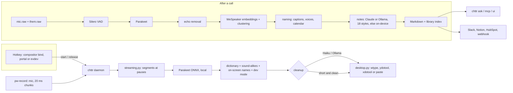

# chttr

[](https://github.com/robjobbed/chttr/actions/workflows/ci.yml)
[](https://github.com/robjobbed/chttr/actions/workflows/bench.yml)
[](https://github.com/robjobbed/chttr/releases)
[](LICENSE)


**Voice dictation and meeting notes for Linux.** Hold a key, talk, let go: clean
text appears in whatever app has focus. Take a call in Zoom, Teams or Meet: get
notes with a name on every line, no bot in the call. Then ask your meetings
questions, from the terminal or from Claude Code.

Speech recognition runs on your machine. Claude (optional) does the best
cleanup and notes; without a key, chttr cleans up your text and writes meeting
notes on your machine. Everything lands in plain files you own.

```text
you say:   "um so send the contract to Sorov by Tuesday, no, Friday"
it types:  Send the contract to Sohrab by Friday.
```


> **1.1, used daily on an Omarchy laptop.** 1,500 tests and real-model
> benchmarks run in CI on every change; GNOME and KDE support is new and would
> love your reports. Issues and fixes welcome:
> [CONTRIBUTING.md](CONTRIBUTING.md).

## What you get

**Dictation** (think Wispr Flow, for Linux)

- **Local, fast recognition.** NVIDIA Parakeet TDT 0.6B v3 on the CPU, in 25
  languages. Streaming recognition transcribes what you said before each pause
  while you keep talking, so letting go of the key leaves about a sentence to
  recognize.
- **Cleanup that reads like you typed it.** Fillers out, punctuation in,
  "Tuesday, no, Friday" becomes "Friday", spoken formatting honoured. Claude
  Haiku, or Ollama for fully offline use, at four levels from `light` to `high`.
  With neither, local rules still remove fillers and turn "comma" and "new
  line" into punctuation; they also take over whenever the model is slow or
  unreachable, so you never wait more than 5 s.
- **It knows where you are.** Terminals get one plain line, editors keep
  identifiers, chat stays casual (line breaks never send the message), email
  gets sentences, and Gmail, Docs or Slack in a browser tab count too. A new
  dictation fits the sentence already before the cursor. Names on screen near
  the cursor fix sound-alike names. Correct a name once and it offers to
  remember it.
- **Developer dictation.** "camel case user id" types `userId`; in editors and
  terminals "at src slash app dot ts" types `@src/app.ts`, "dash dash verbose"
  types `--verbose`, and ending with "run it" presses Enter. Prompts to Claude
  Code, Codex and Aider stay sentences.
- **Quiet mics just work.** The speech threshold follows your room and your
  voice, and the waveform pill (in your Omarchy theme's colours) shows
  listening, transcribing and done.
- **Command mode, hands-free, whisper mode.** Select text and say "make this
  shorter"; double-tap for hands-free; dictate quietly in an open office.

**Meetings** (think Fathom, without the bot)

- **Any call app.** Google Meet through a small extension; Zoom, Teams, Slack,
  Discord, Webex and browser calls noticed by which app holds your microphone.
  chttr records your mic and the other side as separate channels.
- **Names on every line.** Voices are clustered on your machine and named from
  Meet's captions, voices it has heard before, your calendar invite, and Claude
  reading the conversation. People in the room with you get their own label.
- **Notes your way.** 18 styles (general, sales BANT/MEDDPICC, 1:1, standup,
  interview, retro, ...) or your own, switchable after the call, from Claude or
  Ollama; on-device notes with no model at all. Markdown files in
  `~/Documents/Meetings`.
- **A brief before the next one.** Five minutes before a calendar meeting,
  what you agreed with those people last time and what's still open.
- **Ask your meetings.** `chttr ask "what did Dana commit to last month?"`
  answers with citations to the moment; `chttr mcp` gives Claude Code the same
  tools; `chttr ui` is your dictations and meetings in the browser.
- **Send them on.** Slack, Notion, HubSpot or a webhook, one click after the
  call (never without it, unless you say so).

**Built to be trusted**

- Audio never leaves your machine; [exactly what does](#privacy) is in a table.
- Models are pinned to a commit and SHA-256-verified; tokens live in your keyring.
- Works on Hyprland/Omarchy, Sway, niri, KDE Plasma, GNOME and X11.

## Speed

Time from releasing the key to recognized text, measured by `chttr bench` on the
same recordings (synthesized speech, so word error rates are only a smoke test):

| Recording | Full pass over the recording | With streaming (`tail`) |
|---|---:|---:|
| 11 s email, GitHub runner (4 vCPU) | 774 ms | **264 ms** |
| 18 s notes, GitHub runner (4 vCPU) | 1307 ms | **617 ms** |
| 19 s notes, desktop CPU | 708 ms | **334 ms** |

The streaming figure is a quick release 0.2 s after the last word. Letting go
in the pause after it is faster still: chttr reuses the recognition pass that
already ran in that pause, so a short dictation appears at once (`chttr bench`
reports this as `release`, next to `tail`). Cleanup with Claude Haiku adds a
few hundred milliseconds; short phrases with nothing to fix skip it. The [Benchmark workflow](https://github.com/robjobbed/chttr/actions/workflows/bench.yml)
re-measures on every change to `main`; run `chttr bench your.wav` on your machine.

## How it compares

As of October 2026, from each product's own documentation:

| | chttr | Wispr Flow | Fathom | Handy | Meetily |
|---|---|---|---|---|---|
| Runs on Linux | ✓ | ✗ (Mac, Windows, iOS, Android) | Bot only | ✓ | Build from source |
| Speech recognized on your machine | ✓ | ✗ | ✗ | ✓ | ✓ |
| LLM cleanup of dictation | ✓ (Claude or Ollama; local rules without) | ✓ | – | – | – |
| Meeting notes without a bot | ✓ | Notetaker (Mac, Windows) | Mac app | – | ✓ |
| Speaker names | ✓ (captions, voices, calendar) | – | ✓ | – | Planned |
| Ask across all meetings | ✓ (`chttr ask`, MCP) | – | ✓ (Team plans) | – | Planned |
| CRM / Slack / Notion | ✓ | – | ✓ (paid tiers) | – | – |
| Open source | ✓ MIT | ✗ | ✗ | ✓ MIT | ✓ MIT |
| Price | Free (your Claude API usage) | Free tier, Pro $15/mo | Free tier, paid plans | Free | Free, Pro tier |

– not offered, or not in the product's documentation.

## Install

**Omarchy**, as a plugin:

```bash
omarchy plugin add https://github.com/robjobbed/chttr.git --enable
```

Then click the microphone in the bar; that runs the setup in a terminal. Update
later with `omarchy plugin update robjobbed.chttr`.

**Any other Linux desktop:**

```bash
curl -fsSL https://raw.githubusercontent.com/robjobbed/chttr/main/install.sh | bash
```

The installer never uses sudo: if a system tool is missing it prints the one
command for your distribution (pacman, apt, dnf or zypper). Run it again to
update. **Arch** users can also build `packaging/aur/chttr-git/PKGBUILD`.

Either way, setup:

1. installs the `chttr` command with [uv](https://docs.astral.sh/uv/) (your
   Python if it is 3.12 to 3.14; on Arch-based systems uv's own copy, so a pacman
   update can't break it) from a git checkout, so updates are a `git pull` away,
2. downloads the speech model (Parakeet, ~670 MB, skipped if Omarchy's voxtype
   already has it; resumes after a dropped connection) and the meeting models
   (~29 MB), checksum-verified,
3. sets up the hotkeys for your desktop (below),
4. registers the Google Meet extension with Chromium, Chrome, Brave, Vivaldi or
   Edge, and turns on the accessibility switches screen context reads apps with,
5. offers to add a Claude key, if you're at a terminal and have none,
6. starts the daemon as a systemd user service (`chttr.service`), waits until it
   answers, and ends with a card of the shortcuts that are really bound.

Run it again any time (`bin/setup --no-keybindings --no-meet --no-service` skips
parts), and check everything with:

```bash
chttr doctor                     # desktop, typing, hotkeys, engine, cleanup, daemon, calendar, Meet
chttr doctor --fix               # run the fixes that need no sudo, then check again
chttr keys                       # the shortcuts bound right now
```

`chttr uninstall` takes out the service, key bindings and Meet extension again,
restoring each file as it was; `--purge` also deletes chttr's data and settings
(never your meeting notes).

### Desktop support

| Desktop | Hotkeys | Typing | Focused app (per-app modes) | Overlay |
|---|---|---|---|---|
| Hyprland / Omarchy | compositor bindings (added by setup) | wtype | hyprctl | yes |
| Sway | compositor bindings (added by setup) | wtype | swaymsg | yes |
| niri, river, other wlroots | keyboard devices¹ | wtype | niri msg (niri) | yes |
| KDE Plasma 6 (Wayland) | global-shortcuts portal | ydotool² | kdotool (optional) | yes |
| GNOME 48+ (Wayland) | global-shortcuts portal | ydotool² | [Window Calls](https://github.com/ickyicky/window-calls) extension (optional) | notifications |
| X11 (any) | keyboard devices¹ | xdotool | xdotool | notifications |

¹ chttr reads `/dev/input` (it watches the keys, never blocks them); add yourself
to the `input` group once: `sudo usermod -aG input $USER`, then log out and in.
² `ydotool` needs its daemon: `systemctl --user enable --now ydotool`.

On GNOME and KDE the desktop asks you once to confirm chttr's shortcuts; you can
change them later in its keyboard settings. Elsewhere the keys come from
`[hotkeys]` in the config. Without a typing tool, text is pasted, and without
that it lands on the clipboard with a notification.

| Key | What it does |
|---|---|
| Hold **Insert** | Dictate; release to type |
| Hold **Alt+Insert** | Command mode: say what to do with the selected text |
| **Super+Insert** | Hands-free: stops by itself after a pause |
| **Super+Shift+Insert** | Dictation history |
| **Super+Alt+Insert** | Start / stop recording a meeting |

The bar widget shows what chttr is doing: a slashed microphone when it's off
(click to start it), an hourglass while the model loads or it transcribes, a
red dot and timer during a meeting, a dimmed microphone when the speech model
didn't load, and a small dot when only local cleanup is available (no Claude
key or Ollama). Left click opens chttr's menu (record a meeting, last notes,
history, chttr in your browser, settings), right click starts or stops a
meeting recording.

### Claude cleanup

Claude gives the best cleanup and meeting notes. Add an Anthropic API key
(checked with Anthropic, stored readable only by you):

```bash
chttr connect claude             # paste the key; --remove takes it out again
```

Fully offline: install [Ollama](https://ollama.com), `ollama pull qwen2.5:1.5b`
(fast on a laptop CPU; set `[polish] ollama_model`), and leave
`polish.backend = "auto"`, or pick "Use Ollama for cleanup" in the chttr menu.
chttr uses Claude when a key is present, else Ollama when it is running, else
local rules (fillers, spoken punctuation, capitals; no model). Command mode's
common edits (sort lines, title case, bullet list, "delete that" and more) work
without a model; anything else needs one of the two. Meeting notes use the same
choice; with neither, you get on-device notes.

System tools used: `pw-record`/`pw-play` (PipeWire) and `notify-send` everywhere;
`wl-copy`/`wl-paste` on Wayland or `xclip`/`xsel` on X11; a typing tool from the
table above; a menu (`omarchy-menu-select`, or `fuzzel`, `wofi`, `rofi`, `bemenu`).
All of them ship with Omarchy.

## Personal dictionary and snippets

### Lingo

**Lingo** is where you teach chttr how you spell things. Open it from the chttr
menu in the bar (**Lingo: fix how words are spelled**) or with `chttr lingo`.
It opens in your browser and shows your recent dictations: click the word, or
the words, that came out wrong ("Sora Beth Ani"), type how it should be spelled
("Sohrab Behbahani") and press **Always spell it this way**. From the next
dictation on, chttr types it your way, in every app. Below that you can rename
a spelling, drop one of the ways it was misheard, add a word by hand, and try a
sentence to see what chttr would type. Lingo edits the same
`dictionary.toml` as the commands below, and its server stops on its own 15
minutes after you close the page.

```bash
chttr learn Sohrab --heard sorob --heard "so rob"   # correct spelling + what the recognizer hears
chttr fix                                            # show the last dictation, ask what was wrong
chttr fix "so rob" Sohrab                            # same, in one line
chttr snippet "my email" rob@example.com             # say "insert my email"
chttr dictionary                                     # show it all
chttr forget sorob                                   # remove a word, mis-hearing or snippet
```

Names come out of the recognizer a different way each time ("Sorob", "Sorov",
"Suhrab" for Sohrab), so chttr also corrects words that *sound like* a
vocabulary word: same consonant skeleton, capitalized by the recognizer (it
took it for a name), not an English word, and spelled reasonably close. Real
words like "sorry" or "Serbia" are left alone. In meetings, everyone on the
invite and every name Meet's captions showed is corrected the same way. Turn it
off with `sound_alikes = false` at the top of `dictionary.toml`.

`~/.config/chttr/dictionary.toml` is re-read on every dictation. The `--heard`
variants are replaced in the raw transcript (whole words, case-insensitive);
the vocabulary is given to whisper as a prompt and to the cleanup model as
spellings to keep. Snippets are expanded after cleanup, and the model is told
to leave their phrases alone. Snippet phrases match anywhere, so pick ones you
wouldn't otherwise say.

## Meetings

```bash
chttr meeting calendar 'https://calendar.google.com/calendar/ical/…/basic.ics'
```

Setup registers the Meet extension; restart Chromium once to load it. Then
join a call and a notification asks whether to record it (`[meeting] auto =
"ask"`; `"always"` or `"never"` also work):

- **Google Meet**, through the extension, which also tells chttr who is speaking.
- **Zoom, Microsoft Teams, Slack, Discord, Webex, Signal** and other call apps,
  and calls in any browser tab: chttr notices which app holds your microphone
  (PipeWire) and offers to record after a few seconds; it stops when the app
  lets go of the mic. No bot joins the call (`[meeting] detect_calls`).
- Anything else: press **Super+Alt+Insert** (`chttr meeting toggle`).
When the call ends, the notes appear in `~/Documents/Meetings/` as
`2026-10-11 1400 Weekly sync.md`: frontmatter with the attendees, summary,
decisions, action items, open questions, the transcript with timestamps, and
how each speaker was identified.

How it works:

- **Two channels.** `pw-record` captures your microphone and the speaker
  output (the default sink's monitor, so headphones work and switching output
  mid-call is followed) into separate files. Your lines are what your mic
  heard, minus moments Meet had you muted, chttr dictations made during the
  call, and the other side leaking out of your speakers into the mic (detected
  by matching the words on both channels).
- **Voices.** Silero VAD cuts the speaker channel into utterances, WeSpeaker
  ResNet34 embeds each one, and average-linkage clustering groups them into
  voices. The models (~29 MB) download to `~/.local/share/chttr/models` on
  first use. Parakeet transcribes every utterance.
- **Names**, in order of trust:
  1. The **Meet extension**, while chttr is recording the call, turns on Meet's
     captions (hidden again if you hadn't turned them on yourself, and turned
     off when the recording ends) and reports whose name the captions show
     while each voice is talking. A red "chttr is recording" badge stays on the
     page meanwhile. The extension also reports the Meet code, your Meet mute
     button, and when you leave.
  2. **Remembered voices** (`~/.local/share/chttr/voices.json`): every voice
     named by captions, the calendar or you is saved under their email and
     recognised in later meetings, even without captions.
  3. The **calendar**: in a 1:1, the only other invitee.
  4. **Claude** reads the conversation ("thanks, Sarah") against the invite list.
  5. Anything left is `Speaker N`. `chttr meeting rename "Speaker 2" "Sarah Chen" --email sarah@…`
     fixes the notes and teaches chttr the voice.
- **People in the room.** Your microphone's side is split into voices too: the
  one that matches your remembered voice (or talks most) is you, and anyone else
  with real speaking time becomes `In the room 1`, ... (rename them the same
  way). Zoom and Teams desktop calls get names from remembered voices, the
  calendar and Claude, since there are no captions to read
  (`[meeting] room_speakers`).
- **Calendar.** Google Calendar > Settings > your calendar > Integrate calendar >
  *Secret address in iCal format*. No OAuth app to set up; the URL is stored in
  `~/.config/chttr/calendar-urls` (mode 600). The event is found by Meet code,
  else by time; attendees' names and emails go into the notes and help match
  caption names to people.
- **Processing** runs after the call in a separate, niced process
  (`chttr meeting process`): recognition runs at about 7% of real time, so an
  hour of meeting takes 5 to 10 minutes in all. A notification with an Open button appears when the notes are
  written. Audio is deleted afterwards unless `keep_audio = true` (then it's
  kept as stereo Opus next to the notes: you left, them right).

### Ask your meetings

Every meeting (and dictation) goes into a local full-text index
(`~/.local/share/chttr/library.sqlite`), so you can ask across all of them:

```bash
chttr ask "what did Dana commit to last month?"
chttr ask -v "when did we last talk about the Acme pricing?"   # -v shows the searches
```

Claude searches the index with tools (several phrasings, then reads the
transcript around the hits) and answers with citations like
`[Pricing review, 2026-10-01, 00:12:40]`. Only the snippets it asks for are
sent, only when you ask. With Ollama, the local model answers from the best
search results; without either (or with `--local`), `chttr ask` is a ranked
search that prints those citations.

**In Claude Code or Claude Desktop**, the same tools are an MCP server:

```bash
claude mcp add chttr -- chttr mcp
```

Then ask Claude Code things like "check my meetings for what we decided about
the API rate limits" while you work. Read-only: `search_meetings`,
`read_transcript`, `get_notes`, `list_meetings`, `list_action_items`.

**In the browser**, `chttr ui` opens on a Home page (words dictated, time saved,
your streak, recent meetings, what the daemon is doing) with tabs for your
dictations (what chttr heard against what it typed), meetings, action items and
Lingo. Search runs as you type (`speaker:`, `after:`, `before:` and `on:`
filters); transcripts read as turns with follow-along audio when `keep_audio`
kept it; click a speaker to rename them, switch the notes style, or export to
Markdown, JSON or CSV. `chttr ui --open "<citation>"` jumps to a `chttr ask`
citation. It follows your Omarchy theme, works from the keyboard (`?` lists the
keys), and listens on 127.0.0.1 only, with a one-time token in the link.

### Send notes where your team works

```bash
chttr connect slack        # an incoming-webhook URL for the channel
chttr connect notion       # an integration secret + the page that holds your notes
chttr connect hubspot      # a private-app token (contacts read/write)
chttr connect webhook      # any URL; signed with X-Chttr-Signature if you give a secret
chttr connect              # what's connected
```

After each meeting the "notes saved" notification gets a **Send to Slack /
Notion / HubSpot** button per connected destination; nothing leaves without
that click. Slack gets a formatted summary with the action items, Notion a page
with headings and to-dos, HubSpot a note (and a task per action item) on the
attendees' contacts, matched by email. `chttr send [MEETING] [--to slack]`
does it by hand. To send without asking, set `[integrations] send = "always"`,
optionally only for meetings whose calendar title matches `auto_titles`
(say, `'\b(customer|demo)\b'`). Tokens are stored in your desktop keyring
(libsecret), never in the config file.

For anything else, `[integrations] on_meeting_done` runs your own script after
every meeting with the Markdown path as `$1` and the whole meeting as JSON on
stdin.

### Note styles

Notes come in 18 styles, and a meeting can switch style at any time, even
weeks after the call, without re-transcribing:

| Style | For |
|---|---|
| `general` | Summary, decisions, open questions (fits most meetings) |
| `brief` | Executive TL;DR |
| `bant` | Sales qualification: Budget, Authority, Need, Timeline, objections, competitors |
| `meddpicc` | Enterprise sales: Metrics, Economic buyer, Decision criteria/process, Paper process, Pain, Champion, Competition |
| `spin` | Sales discovery: Situation, Problem, Implication, Need-payoff, best quotes |
| `customer-success` | Account health, goals, wins, issues, churn risks, expansion |
| `one-on-one` | Updates, wins, blockers, feedback, growth |
| `standup` | Progress, plans and blockers per person |
| `interview` | Hiring scorecard: evidence by topic, strengths, gaps (no hire/no-hire verdicts) |
| `user-research` | Participant context, goals, pain points, verbatim quotes, insights |
| `support` | Issue, impact, troubleshooting, resolution, root cause |
| `kickoff` | Goals, scope, out of scope, milestones, owners, risks |
| `retro` | Went well, didn't, ideas, changes |
| `brainstorm` | Ideas by theme, most promising, parking lot |
| `decision` | Context, options, decision, rationale, dissent |
| `minutes` | Formal minutes: agenda items, motions and votes |
| `investor` | Metrics, highlights, lowlights, investor feedback, asks |
| `lecture` | Concepts, examples, takeaways, follow-up questions |

Which style a meeting gets, first match wins:

1. what you picked for it: `chttr meeting style bant` (during the call, or
   from the bar menu's *Notes style for this meeting*),
2. a calendar-title rule in `[meeting] style_rules` (1:1s, standups, retros
   and interviews are set up already; add `{ match = "demo|discovery", style = "bant" }`),
3. `[meeting] style`: `"auto"` (the default) lets Claude pick from the
   conversation, or name one style for everything.

After the call:

```bash
chttr meeting style meddpicc                       # rewrite the last meeting's notes as MEDDPICC
chttr meeting style bant --meeting 2026-10-11-1400 # a specific meeting (chttr meeting list)
chttr meeting style --prompt "every number and who said it, plus security concerns"
chttr meeting style bant --prompt "they're also evaluating Gong"   # a style plus extra instructions
chttr meeting styles                               # list them
```

or the bar menu's *Change the last meeting's notes style…*, which includes
*Custom instructions…*. Every version is kept: switching back to a style you
already had is instant and free (`--fresh` writes it again). The transcript is
sent with prompt caching, so trying a few styles in a row costs little.

Your own styles go in `~/.config/chttr/note-styles.toml`, in the same format
as the built-in [`note_styles.toml`](src/chttr/note_styles.toml) (reuse an id to
replace a built-in one):

```toml
[[style]]
id = "podcast"
name = "Podcast episode"
description = "Show notes for a podcast recording."
actions = ""                      # no action items
sections = [
  { title = "Episode summary", guide = "Two paragraphs.", kind = "paragraph" },
  { title = "Timestamps", guide = "Topic changes as mm:ss - topic." },
  { title = "Quotable", guide = "Short verbatim quotes.", kind = "quotes" },
]
```

Note styles need Claude (an API key) or Ollama; long calls on Ollama are
summarized in 15-minute parts first. With neither, you get on-device notes: a
summary, the questions asked, numbers and dates, commitments and action items,
found on your machine. Every meeting also shows each speaker's share of the
talk.

The extension lives in `src/chttr/extension/` and is loaded through Omarchy's
`--load-extension` line in `~/.config/chromium-flags.conf`. Meet's page
structure is undocumented; if names stop appearing after a Meet update, the
caption selectors at the top of `content.js` are the place to look. It reads
English UI labels first, with icon names and Meet's `jsname` attributes as
fallbacks.

**Before the next meeting.** Five minutes before a calendar event with other
people, a notification shows what you agreed last time and the open action
items, from your own notes only (`[meeting] brief_minutes`; 0 turns it off).
During a call it only names the meeting, so nothing shows on a shared screen.
`chttr brief` prints it any time, or for one meeting by title
(`chttr brief standup`). If your calendar feed isn't named after your address,
set `[meeting] email` so chttr knows which invitee is you.

Recording laws differ: in many places everyone on a call has to agree to being
recorded. Tell people.

## Commands

| Command | What it does |
|---|---|
| `chttr daemon` | Run the daemon (loads the model once; ~5 s for Parakeet) |
| `chttr start` / `chttr release` | Push-to-talk press / release |
| `chttr command` | Command-mode press: grabs the selection, then records an instruction |
| `chttr toggle` | Hands-free: start (auto-stops on silence), or stop now |
| `chttr stop` / `chttr cancel` | Stop any recording and transcribe / discard it |
| `chttr history [--print [N]]` | Pick a past dictation and type it again |
| `chttr stats [--days N]` | Words, speaking speed, time saved, per-day chart |
| `chttr fix [WRONG RIGHT]` | Learn a correction from the last dictation |
| `chttr lingo` | Lingo in your browser: fix how words are spelled, from past dictations |
| `chttr learn` / `forget` / `snippet` / `dictionary` | Edit the dictionary |
| `chttr status [--follow] [--json]` | `idle` / `recording` / `transcribing` / `loading` / `off`; `--json` matches the Omarchy bar indicator format |
| `chttr transcribe file.wav [--raw] [--engine E] [-v]` | One-off transcription without the daemon |
| `chttr bench FILE.wav… [--cleanup] [--format FORMAT]` | Time recognition (full pass vs. after release), cleanup, real-time factor; word error rate when FILE.txt exists; FORMAT is text, json or markdown |
| `chttr polish [--app NAME] [--local]` | Clean up text from stdin (`--local`: the local rules only) |
| `chttr doctor [--verify] [--mic] [--fix] [--json]` | Check everything and name the fix; `--fix` runs the safe fixes, `--mic` records a test, `--verify` hashes the models |
| `chttr reload` | Re-read config.toml (switching engines reloads the model) |
| `chttr config` | Create and print the config file |
| `chttr setup` | Models, service, keybindings, Meet extension (what `bin/setup` runs) |
| `chttr keys` | The shortcuts bound right now, and what catches them |
| `chttr uninstall [--purge]` | Remove what setup added; `--purge` also deletes data and settings |
| `chttr menu` | The bar widget's menu |
| `chttr meeting start` / `stop` / `toggle` / `cancel` / `status` | Record a meeting by hand |
| `chttr meeting list` | Recorded meetings and their status |
| `chttr meeting process [ID] [--no-summary]` | (Re)write the notes for a meeting |
| `chttr meeting rename OLD NEW [--email E] [--meeting ID]` | Fix a speaker's name and remember their voice |
| `chttr meeting calendar [URL]` | Add a secret iCal address; show the next 48 hours |
| `chttr meeting style [STYLE] [--prompt TEXT] [--meeting ID]` | Set or switch a meeting's note style |
| `chttr meeting styles` | List note styles |
| `chttr meeting voices [--forget KEY]` | Remembered voices |
| `chttr meeting install` | Register the Meet extension and native host |
| `chttr connect [claude\|slack\|notion\|hubspot\|webhook] [--remove]` | Add a Claude key, or a destination for meeting notes (no argument: list them) |
| `chttr send [MEETING] [--to DEST] [-y]` | Send a meeting's notes to your connected destinations |
| `chttr ask [-v] [--local] QUESTION` | Answer a question from your meetings, with citations (`--local`: search only) |
| `chttr brief [TITLE]` | What you agreed last time with the people in your next meeting |
| `chttr mcp` | Your meetings as an MCP server for Claude Code / Claude Desktop |
| `chttr ui [--port N] [--no-browser] [--open CITATION]` | Your dictations and meetings in the browser |

## Config

[docs/configuration.md](docs/configuration.md) lists every key with its
explanation (it is generated from the defaults chttr writes). `chttr config`
shows yours; in short: engine, whisper model, audio
device, hands-free timings and speech threshold, output mode (`type`, `paste`,
`clipboard`), cleanup backend and models, overlay and live captions, history,
and the `[[modes]]` table.

## How it works



`daemon.py` owns a small state machine (`loading` while the model loads, then
`idle` → `recording` → `transcribing`),
listens on `$XDG_RUNTIME_DIR/chttr/chttr.sock`, and tracks what a recording is
for (dictate, hands-free, command). `recorder.py` runs `pw-record` at 16 kHz
mono and meters every 20 ms chunk; the daemon uses the levels for hands-free
auto-stop and pipes them to `overlay.py`, a GTK4 layer-shell window run under
the system Python (PyGObject and gtk4-layer-shell, preloaded via `LD_PRELOAD`).
While recording, `streaming.py` watches the levels for pauses and transcribes
each finished stretch in the background (cutting in the middle of the pause),
which also feeds the overlay's live captions; after release only the audio
since the last pause is recognized. A new dictation can start while the
previous one is still being cleaned up, and results are typed in order.
`transcriber.py` wraps Parakeet (onnx-asr) and whisper.cpp,
trims silence and filters whisper's silence hallucinations; `levels.py` fits the
speech threshold to the room. `polish.py` holds
the cleanup and command prompts and talks to Claude or Ollama, behind a short
timeout and a breaker; `tidy.py` is the local cleanup. `output.py`
reads the selection (Ctrl+C into an emptied clipboard, restored afterwards;
the primary selection in terminals) and delivers text. `history.py` is the
picker and stats. The state file at `$XDG_RUNTIME_DIR/chttr/state` is what
`status --follow` watches; `state.json` next to it is what the bar reads.

The `meeting/` package is everything after the call: `recorder.py` captures
the two channels, `pipeline.py` runs VAD, transcription, echo removal and
clustering as its own niced process, `naming.py` decides who is who,
`styles.py` and `render.py` write the notes and the Markdown, `lite.py` the
on-device notes, and `edit.py` handles renames. `diarize.py` holds the VAD,
embeddings, clustering and voice memory, `gcal.py` the calendar, `notes.py`
the notes prompt (Claude or Ollama), `models.py`
the pinned model downloads, and `native_host.py` plus `extension/` the Meet
side. `BarWidget.qml` and `manifest.json` make the repo an Omarchy plugin.

## Development

```bash
uv sync --group dev && uv run pytest     # 1,500 tests, no models or audio devices needed
uv run ruff check . && uv run pyright
node --test tests/js                     # the meeting library's JavaScript
```

See [CONTRIBUTING.md](CONTRIBUTING.md) for the layout and guidelines,
[CHANGELOG.md](CHANGELOG.md) for what changed in each release, and
[ROADMAP.md](ROADMAP.md) for what's next.

## Privacy

Audio never leaves your computer. Everything below is all that does, and only
when you turn it on:

| What | Where it goes | When | Turn it off |
|---|---|---|---|
| Dictated text (the transcript) | Anthropic, or your local Ollama | You added an API key / run Ollama | `[polish] backend = "none"` |
| Focused app's window class (e.g. `Slack`) | Same, with the dictation | Cleanup is on | `[polish] use_app_context = false` |
| Focused window's title | Same, with the dictation | Cleanup is on | `[polish] send_window_title = false` |
| Selected text in command mode | Same | You use command mode | Don't use command mode |
| Names near the cursor | Same, as spellings to keep | `[polish] screen_context = "names"` or `"full"` (default `"local"`: used on this machine only) | `"local"` or `"off"` |
| Up to 600 characters before the cursor | Same, as context | `[polish] screen_context = "full"` | Any other value |
| Meeting transcript, invitees' names and emails, calendar title and description | Anthropic, or your local Ollama | You added an API key / run Ollama | `[meeting] summary = false` |
| Snippets of your meetings that Claude searches for | Anthropic | You run `chttr ask` (or an MCP client asks) | Don't use them |
| A meeting's notes, action items and attendees' emails | Slack / Notion / HubSpot / your webhook | You click "Send to …" (or set `send = "always"`) | Don't connect them |
| Calendar feed request | Google | You added a secret iCal address | Remove it from `calendar-urls` |
| Model downloads (once, checksum-verified) | Hugging Face | `chttr setup` | Copy the models in by hand |

Reading the text field (for names on screen and to notice your corrections)
happens on this machine through AT-SPI and is never stored. Meeting audio is
deleted once the notes are written unless you set `keep_audio = true`, and
dictation audio is only kept with `[history] keep_audio_days`. Dictation history, meeting data and remembered voices stay
in `~/.local/share/chttr`, readable only by you. The Meet extension talks only
to the local daemon. Your calendar's secret iCal URL is stored with mode 600.
To report a security problem, see [SECURITY.md](SECURITY.md).

## License

MIT
